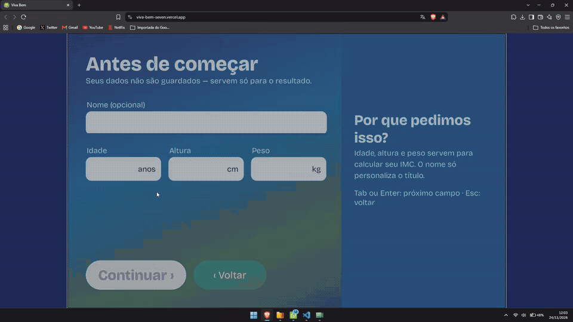

# 🌱 Viva Bem — Quiz de Hábitos Saudáveis


## 📖 Sobre o projeto

O Viva Bem é uma aplicação interativa desenvolvida para promover hábitos saudáveis por meio de um quiz gamificado sobre sono, hidratação, atividade física e alimentação.

O projeto foi desenvolvido como atividade de extensão do curso de Análise e Desenvolvimento de Sistemas, em Belém/PA.

A aplicação utiliza Python e Pygame, com execução diretamente no navegador por meio do Pygbag, oferecendo suporte a computadores e dispositivos móveis.

## 🌐 Demonstração online !
![Demonstração do Viva Bem] 
 

[Acessar o Viva Bem](https://viva-bem-seven.vercel.app/)

## 🚀 Funcionalidades

- Quiz interativo com oito perguntas.
- Dois modos de utilização: avaliação inicial e acompanhamento.
- Sistema de pontuação por categoria.
- Feedback personalizado conforme as respostas.
- Cálculo de Índice de Massa Corporal (IMC).
- Interface adaptada para desktop e dispositivos móveis.
- Integração com teclado nativo em dispositivos móveis.
- Personagem interativo que reage às respostas no desktop.
- QR Code para acesso rápido à aplicação.
- Validação dos dados informados.
- Testes automatizados.
- Publicação automatizada na Vercel.

## 🛠️ Tecnologias utilizadas

| Tecnologia | Aplicação |
|---|---|
| Python | Lógica e desenvolvimento da aplicação |
| Pygame | Interface gráfica e interatividade |
| Pygbag | Execução no navegador |
| HTML | Formulários para dispositivos móveis |
| Pytest | Testes automatizados |
| PowerShell | Automação de build e publicação |
| Git e GitHub | Controle de versão |
| Vercel | Hospedagem da aplicação |

## 📂 Arquitetura do projeto

```text
quiz/
├── main.py
├── telas.py
├── conteudo.py
├── regras.py
├── ui.py
├── boneco.py
├── formulario_web.py
├── assets/
└── build/web/

testes/
ferramentas/
docs/
apresentacao/
publicar.ps1
pytest.ini
vercel.json
```

O projeto possui uma arquitetura modular, separando a interface gráfica, as regras de negócio, o conteúdo educacional e os testes automatizados.

O diretório `quiz/build/web/` contém os arquivos gerados pelo Pygbag e não deve ser editado manualmente.

## ⚙️ Instalação e execução

### Pré-requisitos

- Python
- Git
- Pip

### Clonar o repositório

```bash
git clone https://github.com/sergio-stanley/viva-bem.git
cd viva-bem
```

### Instalar dependências

```bash
py -m pip install pygame pygbag pytest
```

### Executar localmente

```bash
py quiz/main.py
```

### Executar no navegador

```bash
py -m pygbag quiz
```

Acesse http://localhost:8000.

## 🧪 Testes automatizados

Os testes utilizam Pytest para verificar as regras da aplicação, incluindo pontuação, validações e cálculos.

```bash
py -m pytest -q
```

## 📦 Build e deploy

O projeto possui um script PowerShell responsável pela geração do build, criação do commit e envio das alterações ao GitHub.

```powershell
.\publicar.ps1 "Descrição das alterações"
```

A Vercel realiza a publicação a partir das alterações enviadas ao repositório.

## 📝 Manutenção do conteúdo

As perguntas, dicas e orientações podem ser modificadas no arquivo `quiz/conteudo.py`.

Cada pergunta possui três alternativas, com pontuações de 0, 1 ou 2. Após modificar o conteúdo, execute os testes automatizados antes de publicar.

## 🔒 Privacidade e responsabilidade

A aplicação não armazena dados pessoais. As orientações apresentadas possuem caráter educativo e não substituem a avaliação de um profissional de saúde.

## 👨‍💻 Desenvolvedor

**Sergio Stanley**

Responsável pelo desenvolvimento técnico da aplicação, incluindo:

- Estruturação da arquitetura do projeto.
- Desenvolvimento da interface gráfica.
- Implementação das regras de negócio.
- Integração com o ambiente web.
- Implementação de testes automatizados.
- Versionamento e publicação da aplicação.

Projeto desenvolvido com auxílio de ferramentas de inteligência artificial durante o processo de desenvolvimento.

[Meu GitHub](https://github.com/sergio-stanley)
